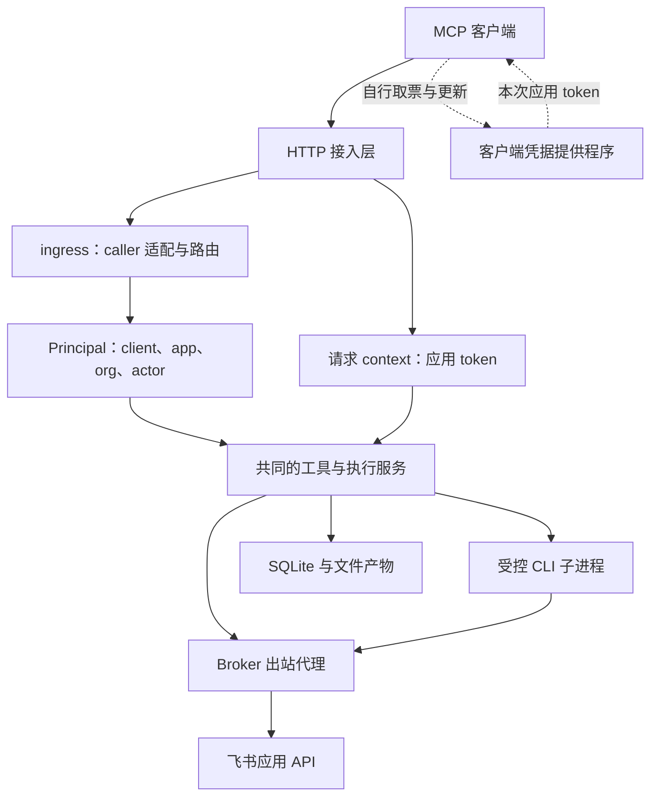

# 请求凭据、调用方与应用路由设计

本次改造把 Gateway 定位为通用飞书 MCP 服务：客户端负责提供可用的飞书应用访问 token，Gateway 负责解释 MCP 操作、选择已配置的应用连接、执行请求并返回结果。QoderWake 是可选的调用方字段适配器。

新接入采用 `request_bearer` 模式。App Secret 不进入这条调用链，不写入网关配置、数据库或子进程。旧 `managed` 模式继续兼容既有安装；仍采用该模式的应用连接继续由网关读取既有 `secret_env` 并取票，旧配置省略 `credential_mode` 时也属于该兼容路径。

本文与本次 `0.4.0-dev` 实现一并交付，仓库基线为 `b792cdf9f989a2825a350dd3be21a0720a2a3e07`。实际测试范围和结果见文末“实施与验证记录”。

## 目录

1. [目标与范围](#1-目标与范围)
2. [一次请求的四部分](#2-一次请求的四部分)
3. [组件职责](#3-组件职责)
4. [应用凭据模式](#4-应用凭据模式)
5. [调用方适配与身份归属](#5-调用方适配与身份归属)
6. [应用路由](#6-应用路由)
7. [配置与请求示例](#7-配置与请求示例)
8. [持久化与生命周期](#8-持久化与生命周期)
9. [错误行为](#9-错误行为)
10. [兼容、迁移与回退](#10-兼容迁移与回退)
11. [客户端集成边界](#11-客户端集成边界)
12. [实施与验证记录](#12-实施与验证记录)

## 1. 目标与范围

### 本次实现范围

- 增加按请求提供飞书应用 Bearer token 的方式，客户端自行获取、缓存和更新 token。
- 将调用方 Header 的读取和规范化移到独立的 `internal/ingress` 包。
- 保留 `client` 和旧 `wake_actor` 行为，新增通用 `actor` 身份模式。
- 支持每个客户端按调用方字段选择已配置的应用连接；支持显式选择该客户端已有的路由。
- 保持 Operation 目录、MCP 工具、文件、回执和现有执行器的共同执行链。
- 持久记录应用连接与真实应用 metadata 的绑定，避免重启后复用连接 ID 导致历史数据归属变化。

### 本次不做

- 不建立网关账户注册、密码登录、临时账户或短期网关 token 发行服务。
- 不接收客户端提交的 App Secret，不替客户端执行 `client_credentials` 交换。
- 不加入个人 OAuth、用户访问 token（UAT）或个人 profile 回退。
- 不接受请求提供任意飞书代理 URL、外部 API 地址或未配置的应用连接。
- 不根据请求重新注册共享 MCP Server 的工具。
- 不把 QoderWake 本地配置、安装目录或启动脚本作为网关依赖。
- 新 `request_bearer` 模式首版不执行后台 Job，不托管请求 token 以便重启后恢复执行。
- 不改动生成的 catalog、guidance、coverage 或 Skill。

“无头”描述程序作为后台服务运行；“按请求提供凭据”描述 token 来自哪里。两者可以同时成立。一个安装包仍可以包含常驻 Gateway 和按需启动的 `lark-cli-gateway` 两个 Go 二进制，不需要为本次改造重写进程隔离结构。

## 2. 一次请求的四部分

| 部分 | 数据 | 提供者 | 用途 | 是否进入持久记录 |
|---|---|---|---|---|
| 网关接入身份 | `Authorization: Bearer <gateway-client-key>` | MCP 客户端 | 找到已配置的 `Client` | 记录客户端 ID；原始 key 不写入调用记录 |
| 上游应用凭据 | `X-Feishu-Access-Token`、`X-Feishu-App-Id` | 客户端的连接层或凭据辅助程序 | 对本次选中的飞书应用执行请求 | token 不持久化，只放在请求 context |
| 调用方 metadata | QoderWake Sender Header 或明确配置的通用 Header | 已通过网关接入认证的客户端 | 可选路由，以及 `actor` 模式的归属 | 路由所需的非秘密匹配字段和稳定 actor 可进入 `Principal`；显示名称和 token 不进入 |
| 业务参数 | MCP 工具名、`operation_id`、`arguments`、文件引用等 | Agent 的工具调用 | 表达要执行的飞书操作 | 按现有回执、幂等和文件规则保存 |

这四部分不能互相代替：

- 飞书应用 token 不能直接替代 Gateway 的客户端 key。
- caller 只是已认证客户端对调用方的声明，不是 App Secret，也不是飞书授权 token。
- `X-Feishu-App-Id` 用于与已经选定的应用 metadata 核对；它不能创建应用连接或绕开路由。
- 模型不能通过 `arguments` 指定凭据、caller、路由或执行应用。
- 管理接口继续使用独立的管理 key。它不成为业务客户端 key，也不用于飞书出站请求。

`access-keys.json` 不属于新增模式的协议或必需运行文件。Gateway 仍可只保存客户端 key 的摘要；原始 key 由实际使用它的 MCP 客户端持有。飞书应用 token 则由客户端在每次需要出站的请求中提供。

## 3. 组件职责



### `internal/ingress`

该包只使用 Go 标准库，负责可复用的接入规则：

- 读取已配置的调用方 Header，拒绝重复或格式不合要求的关键字段。
- 将平台字段转换为统一的 `source/channel/id/id_type/name/open_id/union_id`。
- 生成稳定的 actor 标识。
- 对路由条件做精确匹配，处理显式选择、优先级和冲突。

它不读取环境变量中的 App Secret，不访问飞书，不访问 SQLite，不注册 MCP 工具，也不承担业务操作范围判断。

### Gateway HTTP 与执行层

HTTP 层首先识别客户端，再使用该客户端的适配器与路由配置。选中的应用连接写入 `Principal`；请求携带的上游 token 放入独立的、只存在于内存中的 context 值。

`Principal.Routing` 可以保留用于再次选路的非秘密 `Caller` 匹配字段与 `RequestedRoute`，其中去掉 `Name`。配置热加载后，服务据此重新判断原请求是否仍能选择同一个应用，不把一次选路结果永久当成当前配置仍允许的证明。

实际执行仍经过现有 Operation、资源规则、并发管理、回执和 Broker。CLI 只拿到本次代理入口和原有执行参数，不获得上游 token 或 App Secret。

## 4. 应用凭据模式

在 `apps[]` 中新增 `credential_mode`：

| 值 | 省略时的行为 | 凭据来源 | `secret_env` | `dpop_mode` | 后台执行 |
|---|---|---|---|---|---|
| `managed` | 旧配置默认采用此值 | 原有网关 TokenManager | 保留原有要求 | 维持原有 `preferred/required/disabled` | 维持原有行为 |
| `request_bearer` | 必须显式选择 | 本次请求 Header | 必须为空或省略 | 省略时为 `disabled`，也只允许此值 | `async=true` 明确拒绝 |

新模式继续配置 `id`、`organization_id`、`app_id` 和 `brand`。这些是应用 metadata 和路由目标，不包含取票用的秘密。`request_bearer` 应用本版拒绝非空 `event_types`、`event_verify_token_env` 和 `event_encrypt_key_env`，不借用长期回调凭据建立后台事件入口。

### Header 约定

```http
Authorization: Bearer <GATEWAY_CLIENT_KEY>
X-Feishu-Access-Token: <FEISHU_APPLICATION_ACCESS_TOKEN>
X-Feishu-App-Id: <APP_ID_OF_SELECTED_CONNECTION>
```

- `X-Feishu-Access-Token` 是原始 token，值里不再加 `Bearer `。
- `X-Feishu-App-Id` 必须与最终路由选中的 `apps[].app_id` 完全一致。
- 每个关键 Header 至多有一个值；不通过取第一个值或最后一个值来解决冲突。
- 认证凭据只从约定 Header 读取；客户端不得将 token 放入 URL 查询参数、MCP 工具参数、文件名或 caller 字段。网关不检测任意业务文本是否夹带 token，也不把普通文本自动当作认证输入。
- 新模式缺少或拒绝 token 时直接返回错误，不回退到其他应用、`managed` 取票或个人身份。
- 外部 token 不进入全局 TokenManager 缓存。一次请求结束后，后续请求必须重新提供自己的 token。

只有实际需要飞书出站的业务执行才要求这两个上游 Header。MCP 初始化、`tools/list`、`feishu_context`、本地文件上传/读取和回执查询无需上游 token，但仍要满足 Gateway 客户端身份、caller、路由与当前数据归属规则。

客户端可以在 token 有效期间多次提供同一个 token。“每请求提供”不等于“每请求向飞书取新 token”。token 缓存和过期处理留在客户端的连接层。

### 为什么首版关闭外部 DPoP

DPoP token 的使用需要与其绑定的私钥生成针对实际出站请求的证明。只有一个 token 字符串，Gateway 无法为其生成有效证明；客户端对网关 URL 生成的证明也不能直接作为飞书目标 URL 的证明复用。

本次不传递 DPoP 私钥，也不增加远程签名协议。因此 `request_bearer` 只接受适用于 Bearer 调用的应用 token，并将 `dpop_mode` 默认设为且限制为 `disabled`。若客户端取得的是 DPoP 绑定 token，应在客户端改用适用的 Bearer 取票方式，或等待独立的 DPoP 代理设计；不能声称将配置改为 `disabled` 就能把已有 DPoP token 转成 Bearer token。

### 外部 token 与 App ID 的关系

本次只能确认请求声明的 `X-Feishu-App-Id` 等于已配置路由目标的 `app_id`，没有对外部 token 做上游 introspection，也不能从不透明 token 字符串独立证明其实际应用归属、企业归属或 token 类型。

因此这里的绑定依赖已通过 Gateway 客户端 key 认证的调用方正确提供应用 token。最终 token 是否有效以及能访问哪些飞书资源由飞书响应决定。不要把这项本地 metadata 比对描述为“已向飞书验证 token 属于该 App ID”。

## 5. 调用方适配与身份归属

### 适配器配置

每个 `Client` 可配置 `caller_adapter`：

| `kind` | 行为 | 规范化 `source` |
|---|---|---|
| `none` | 不解析调用方字段 | 空 |
| `qoderwake` | 读取 QoderWake 的五个 Sender Header | `qoderwake` |
| `headers` | 按本客户端的 `headers` 映射读取通用 Header | `headers` |

普通客户端省略适配器时等同于 `none`。旧 `identity_mode=wake_actor` 省略适配器时继续使用 QoderWake，以保留原配置。

`actor` 模式必须配置非 `none` 的适配器；`wake_actor` 只接受 QoderWake 适配器。通用 Header 映射必须给出 `channel` 与 `id` 的 Header 名，其余字段可省略。映射不能重复，也不能将 Authorization、token、Secret、Cookie 等凭据 Header 当成 caller 字段读取。

### QoderWake 五字段映射

| 入站 Header | 规范化字段 | 用途 |
|---|---|---|
| `X-QoderWake-AtWaker-Sender-Channel` | `channel` | 平台与路由条件 |
| `X-QoderWake-AtWaker-Sender-Id` | `id` | 主调用方 ID |
| `X-QoderWake-AtWaker-Sender-Name` | `name` | 描述性 metadata；不作为 actor 或路由匹配键 |
| `X-QoderWake-AtWaker-Sender-Open-Id` | `open_id` | 可选精确路由条件 |
| `X-QoderWake-AtWaker-Sender-Union-Id` | `union_id` | 可选精确路由条件 |

`id_type` 由渠道语义确定，不把 Open ID、Union ID 或名称自动并入主 ID：

| QoderWake `channel` | `id_type` | actor 格式 |
|---|---|---|
| `feishu` | `user_id` | `feishu:user_id:<id>` |
| `lark` | `user_id` | `lark:user_id:<id>` |
| `dingtalk` | `staff_id` | `dingtalk:staff_id:<id>` |
| `dingtalk-user` | `staff_id` | `dingtalk-user:staff_id:<id>` |
| `wecom-bot` | `userid` | `wecom-bot:userid:<id>` |

QoderWake 是 caller 来源，执行应用仍是所选的飞书应用。钉钉或企业微信 caller 不会把执行器切换为那些平台的 API。

Header 名称按 HTTP 规则忽略大小写，字段值按原值精确匹配。ID、Open ID、Union ID 最长 128 字节，渠道与 ID 类型最长 64 字节，不能含空白、控制字符、冒号或逗号。名称按 URI component 解码，保留 `+` 本身；名称内容无效时丢弃显示名，不用它阻断本来可识别的调用。重复 Header 仍属于格式错误。

### 通用 Header 适配器

```json
{
  "caller_adapter": {
    "kind": "headers",
    "headers": {
      "channel": "X-Caller-Channel",
      "id": "X-Caller-Id",
      "id_type": "external_id",
      "name": "X-Caller-Name",
      "open_id": "X-Caller-Open-Id",
      "union_id": "X-Caller-Union-Id"
    }
  }
}
```

注意：`headers.id_type` 是固定的标识类型字符串，**不是 Header 名称**；省略时为 `external_id`。其他列出的字段是待读取的 Header 名称。actor 格式为 `<channel>:<id_type>:<id>`。

### 身份模式独立于适配器

| `identity_mode` | caller 是否可用于路由 | 业务访问是否需要 caller | 数据归属 | `actors` 的含义 |
|---|---|---|---|---|
| `client` | 配置适配器后可以 | 不需要 | 保持接入客户端与所选应用的归属，不加入 caller | 不因为传了 caller 自动切成 actor 模式 |
| `actor` | 可以 | 需要有效 caller；初始化和发现可以缺失 | 使用规范化 actor 隔离文件、调用与游标 | 非空时按已列出的 actor 收窄；空时信任已认证客户端传入的有效 caller |
| `wake_actor` | 继续兼容 | 保持旧规则 | 保持旧 `feishu:user_id:…` / `lark:user_id:…` 归属 | 继续要求明确的非空白名单 |

`name` 变化不会创建新 owner。新 `actor` 模式也不会将 `open_id`、`union_id` 与主 ID 猜测为同一人。需要统一跨渠道用户时，应由调用方明确提供稳定 ID，再使用通用 Header 适配器。

`actor` 模式的空 `actors` 不是飞书用户登录：它表示网关信任已经持有该客户端 key 的调用方提供 caller。对于普通客户端，应使用 `client`；对于能可靠传递实际调用方的桥接客户端，再选择 `actor`。

## 6. 应用路由

路由配置位于 `clients[].routes[]`。路由只在所属客户端内部生效，只能选择已配置的应用连接。

```json
{
  "id": "engineering",
  "priority": 20,
  "match": {
    "sources": ["qoderwake"],
    "channels": ["feishu"],
    "ids": ["example-user-id"],
    "id_types": ["user_id"],
    "open_ids": ["example-open-id"],
    "union_ids": ["example-union-id"]
  },
  "app_connection_id": "engineering-app"
}
```

### 精确匹配规则

1. 一个字段列表内为 OR，例如 `channels=["feishu","lark"]` 表示其中任意一个。
2. 不同的非空字段列表之间为 AND。上面的完整示例要求六组条件同时满足。
3. 省略或为空的条件不额外限制该字段。缺失的 caller 字段不能命中要求该字段的条件。
4. 使用值的精确匹配，不执行模糊名称匹配、前缀匹配、正则或个人身份推断。
5. 自动路由选择所有匹配项中 `priority` 最高的一条；多个最高优先级项同时命中时返回冲突，即使它们指向同一个应用也不例外，不靠配置顺序取第一条。省略 `priority` 时为 `0`。
6. 未显式选路由且没有自动匹配项时，回到该客户端的 `app_connection_id`。

空 `match` 可以表示通配路由，仍参与相同的优先级和歧义判断。需要默认落点时，一般使用客户端的 `app_connection_id`；通配路由适合有意覆盖默认选择的配置。

对于不需要某组条件的路由，应省略该字段。不要为了补全示例而给 `open_ids` 或 `union_ids` 填占位字符串，否则没有这些字段的请求将无法匹配。

### 显式路由选择

客户端可以发送：

```http
X-Feishu-Gateway-Route: engineering
```

它只能选中**当前客户端配置中** ID 为 `engineering` 的路由，而且请求仍必须满足该路由的 `match`。显式选择失败时直接报错，不回到默认应用，不退到另一条自动路由。

这个 Header 不接受应用 ID、URL 或任意上游名称。调用方需要直接选某个应用时，管理员先为该客户端配置相应路由，再由调用方选择路由 ID。

### 路由不改变的约定

- 客户端的 `packs`、`operations`、`high_risk_operations` 和资源规则仍作用于选中的应用。
- 配置了 actor 范围时，继续与客户端范围共同作用。
- 同一客户端不因为路由变化获得新的 Operation 集合；每请求不重新修改共享 MCP 工具注册。
- app、organization 和 actor 参与现有 owner 规则。换到另一个应用不能继续访问前一个应用归属下的文件、回执或游标。
- 请求中的 caller 即使只用于路由，也必须经过该客户端配置的适配器，不能由业务参数覆盖。

`Owner()` 明确只使用原有四个字段：`ClientID`、应用连接 ID、`OrgID`、`Actor`。新增的 `Routing`、路由名称、显示名称和 token 都不参与 owner 计算。`client` 模式下，caller 变化但选中的应用不变时，owner 不变；如果 caller 触发了另一个应用路由，owner 会因为应用连接变化而变化。

## 7. 配置与请求示例

### 7.1 通用客户端最小配置

下面是严格 JSON。所有 `REPLACE_WITH_…` 必须替换；这里只开放两个读取操作用于首次连接，不表示网关全部能力只有这两项。

```json
{
  "listen": "127.0.0.1:18790",
  "data_dir": "./data",
  "cli_binary": "/absolute/path/to/lark-cli-gateway",
  "cli_sha256": "REPLACE_WITH_WRAPPER_SHA256",
  "catalog_revision": "REPLACE_WITH_CATALOG_REVISION",
  "workers": 4,
  "apps": [
    {
      "id": "default-app",
      "organization_id": "example-organization",
      "app_id": "REPLACE_WITH_FEISHU_APP_ID",
      "brand": "feishu",
      "credential_mode": "request_bearer",
      "dpop_mode": "disabled"
    }
  ],
  "clients": [
    {
      "id": "generic-agent",
      "app_connection_id": "default-app",
      "key_sha256": "REPLACE_WITH_GATEWAY_CLIENT_KEY_SHA256",
      "identity_mode": "client",
      "caller_adapter": {"kind": "none"},
      "packs": [],
      "operations": ["wiki.spaces.list", "drive.files.list"],
      "resource_mode": "application_scope",
      "max_concurrent": 2,
      "tool_view": "compact"
    }
  ]
}
```

`catalog_revision` 由配套 Gateway 的 `--catalog-revision` 获取；后端摘要由实际配套 `lark-cli-gateway` 计算。配置校验仍检查两者，不应直接跳过原有版本约束。

客户端以 Streamable HTTP 连接 `http://127.0.0.1:18790/mcp`。如果 Gateway 位于另一台机器，URL 必须指向客户端实际可访问的网关地址，而不是照抄本机回环地址。

### 7.2 QoderWake caller 与路由

先在 `apps[]` 中配置 `default-app` 和 `engineering-app` 两个目标，再在需要路由的客户端上设置：

```json
{
  "identity_mode": "client",
  "caller_adapter": {"kind": "qoderwake"},
  "routes": [
    {
      "id": "engineering",
      "priority": 20,
      "match": {
        "sources": ["qoderwake"],
        "channels": ["feishu"],
        "ids": ["example-user-id"]
      },
      "app_connection_id": "engineering-app"
    }
  ]
}
```

这里仍是 `identity_mode=client`：caller 用于选择应用，文件和回执不按提问者分开。如果需要按提问者分开归属，将其明确改为 `identity_mode=actor`，并根据需要添加 `actors`。

```json
{
  "identity_mode": "actor",
  "caller_adapter": {"kind": "qoderwake"},
  "actors": {
    "feishu:user_id:example-user-id": {
      "operations": ["wiki.spaces.list", "drive.files.list"]
    }
  }
}
```

若路由选中了 `engineering-app`，客户端本次的 `X-Feishu-App-Id` 和 token 都必须对应它。路由只选择配置目标，不替客户端取另一套 token。

### 7.3 一个同步调用的 Header 与 body

```http
POST /mcp HTTP/1.1
Content-Type: application/json
Accept: application/json, text/event-stream
Authorization: Bearer <GATEWAY_CLIENT_KEY>
X-Feishu-Access-Token: <FEISHU_APPLICATION_ACCESS_TOKEN>
X-Feishu-App-Id: <APP_ID_OF_SELECTED_CONNECTION>
```

```json
{
  "jsonrpc": "2.0",
  "id": 2,
  "method": "tools/call",
  "params": {
    "name": "feishu_execute_read",
    "arguments": {
      "operation_id": "wiki.spaces.list",
      "arguments": {"params": {"page_size": 20}}
    }
  }
}
```

示例 body 只展示业务调用，实际客户端仍须按 MCP 完成初始化，并按协商的协议发送后续请求。凭据由连接层附加，不加入 `arguments`。

## 8. 持久化与生命周期

### 不持久化外部 token

`request_bearer` token 只进入当前请求 context，随同步调用传给 Broker：

- 不进入 `Principal`，因此不会通过 `encode(Principal)` 写入 invocation 或 transfer。
- 不进入 SQLite 表、MCP 回执、错误消息、日志或状态接口。
- 不进入 CLI 参数、环境变量、工作区或文件产物。
- 不进入全局 token 缓存，也不在请求结束后为下一次调用保留。

不能通过“把 token 放进 Principal，序列化时临时删字段”实现这一点。应从类型与传递路径上分离调用归属和易失凭据。

同步操作仍按现有行为保存普通业务参数、结果和文件 metadata。客户端不得自行把凭据放入普通业务参数；这条路径保存业务内容的语义没有改变。

### 首版只同步执行

外部 token 的寿命由客户端与飞书决定，网关没有 Secret 来续期，也不保存 token 供后台 worker 重新执行。因此在 `request_bearer` 应用上：

- `async=true` 在创建后台任务之前明确拒绝。
- 同步调用使用本次请求的 context；客户端断开、超时或取消按既有同步调用流程处理。
- token 失效由客户端重新获取；网关不切换到托管身份，也不重复签发外部 token。
- 如果某个飞书 API 自身返回 `task_id`、`ticket` 或 processing 状态，该结果仍按上游原样表达。后续查询是客户端另发一个携带有效 token 的同步请求。
- 同步调用已经产生的回执、文件和游标继续按原 owner 访问，不需要把 token 当作持久 owner 的组成部分。

这不取消 `managed` 应用既有的后台 Job。混合部署时，每次根据最终选中的应用模式判断。

### 应用连接 metadata 绑定

应用连接 ID 是历史数据中的归属依据。仅在进程内检查重载，不能阻止停服后将同一个连接 ID 改成另一家企业或另一个真实 App ID。

本次增加数据库中的连接绑定记录，将 `app_connection_id` 与稳定的 `organization_id`、`app_id`、`brand` 关联。启动与重载都必须保持同一连接 ID 的绑定一致；更换真实应用时创建新的连接 ID。

这里保存的是应用 metadata，不保存 App Secret 或外部 token。`credential_mode` 表达凭据来源；同一个真实应用从旧托管模式迁移到请求模式时，不应仅因凭据来源变化而把原有业务数据归属改成另一应用。

### SQLite 版本

本次将 schema 从 v4 升到 v5，并增加用于排队任务领取的 partial index。索引改善既有 `state='queued'` 的领取查询，不将新请求 token 任务加入后台队列。

v4 历史 Principal 仅保存连接 ID 和 organization 等有限字段，不能可靠恢复历史真实 App ID 与 brand。首次登记只能以迁移时配置的 metadata 为起点，不能声称已经验证了旧记录一直属于该真实应用。

## 9. 错误行为

以下表格按本次改动中的错误类型说明行为，测试证据见实施记录。入口层错误使用相应 HTTP 状态；工具执行阶段错误继续出现在 MCP 工具结果的结构化错误中。错误消息不回显 key、token 或请求 Header 原文。

| 情况 | 返回行为 | 不允许的处理方式 |
|---|---|---|
| Gateway key 缺失、重复或不匹配 | 沿用接入未认证响应；不进入工具执行 | 将飞书 token 当客户端 key |
| caller 字段重复、主 ID/渠道组合不合法 | 明确返回调用方字段错误 | 猜测、拼接多个 Header 值 |
| `actor` 模式业务操作缺 caller | 明确要求 caller；初始化/发现按约定可缺失 | 临时降级成 client owner |
| 非空 `actors` 中没有该 actor | 明确拒绝 | 自动给 caller 建账户 |
| 显式 route 不存在或 `match` 不满足 | 明确路由错误 | 回到默认应用或猜另一条路由 |
| 多条自动 route 最高优先级相同且都匹配 | 明确路由冲突 | 靠 JSON 顺序选一个 |
| 路由指向未配置或已停用应用 | 配置加载或请求时报错 | 使用未配置的 App ID/URL |
| `request_bearer` 配了 `secret_env`、`event_types` 或非 disabled DPoP | 配置校验失败 | 静默忽略或读取 Secret、启用事件入口 |
| 出站操作缺少外部 token 或 App ID Header | 明确缺少本次应用凭据 | 从前一个请求缓存取 token |
| Header App ID 与选中应用不一致 | 明确应用声明冲突 | 按 Header 改写目标应用 |
| 外部 token 失效或不适用于出站请求 | 返回可定位的上游错误，由客户端更新 token | 取票、刷新或切换托管身份 |
| `request_bearer` 请求 `async=true` | 明确说明该模式只支持同步；不登记 queued Job | 保存 token 后偷偷后台执行 |
| 启动/重载复用连接 ID 指向不同 metadata | 明确拒绝绑定变更 | 让旧文件和回执自动归到新应用 |

主要错误类型与层次：

| `Fault.Kind` 或配置错误 | 层次/状态 | 含义 |
|---|---|---|
| `unauthenticated` | HTTP 401 | Gateway 接入凭据无效或不唯一 |
| `invalid_request_header`、`invalid_caller` | HTTP 400 | 关键 Header 重复或 caller 格式不合法 |
| `route_invalid`、`route_ambiguous` | HTTP 400 | 路由选择格式不合法或自动选择冲突 |
| `route_not_found`、`route_denied` | HTTP 403 | 显式路由不属于本客户端，或不满足 match |
| `application_disabled`、`actor_denied` | HTTP 403；执行时也可能返回工具错误 | 选中应用不可用或 actor 未列入配置范围 |
| `credential_mode_mismatch` | HTTP 403 | 给 managed 应用发送了请求级上游凭据；不会忽略这些 Header 后继续使用托管身份 |
| `upstream_credential_invalid` | HTTP 400 | 上游 token/App ID 仅提供一项或内容格式错误 |
| `upstream_app_mismatch` | HTTP 403；执行时也可能返回工具错误 | 声明的 App ID 或请求凭据绑定不匹配选中应用 |
| `upstream_credential_required` | 工具执行错误 | 需要飞书出站时未提供本次 token |
| `actor_required`、`access_revoked` | 工具执行错误，文件接口按其 HTTP 错误返回 | 缺少必要 caller，或当前路由/绑定/接入配置已改变 |
| `request_credential_async_unsupported` | 工具执行错误 | request_bearer 不接受后台任务；managed 切换为该模式后旧后台任务也不能继续执行 |
| 无效模式、event_types、DPoP、SecretEnv 或持久绑定冲突 | 配置加载、启动或重载错误 | 保持原服务或停止启动，要求调整配置 |

## 10. 兼容、迁移与回退

### 既有配置

- 省略 `credential_mode` 的应用连接继续采用 `managed`。
- 省略 `caller_adapter` 的普通客户端继续不读取 caller。
- 旧 `wake_actor` 继续采用旧 QoderWake Header 和白名单约定。
- 未配置 `routes` 的客户端继续使用 `app_connection_id`。
- 原始 key、actor、应用连接 ID 不因升级自动改名。

### 推荐迁移步骤

1. 先阅读仓库 [AGENTS.md](../AGENTS.md) 和 [本地 AI 交接说明](LOCAL-AI-HANDOFF.md)。在隔离工作区应用代码改动，不先改正在运行的配置。
2. 明确现有 `app_connection_id` 对应的真实企业、App ID 与 brand；首次 v5 登记前由维护者确认配置与历史部署一致。
3. 停止写入或停止旧服务后，备份当前配置、配套二进制和整个数据目录。SQLite 运行中应使用一致性备份方式，不能只随意复制正在写入的主 DB 文件而漏掉 WAL 或文件产物。
4. 使用独立副本测试 v4 到 v5 升级，确认旧 managed 配置、文件、回执、actor 与队列行为。
5. 为准备迁移的真实应用将 `credential_mode` 设为 `request_bearer`、`dpop_mode` 设为 `disabled`，删除它的 `secret_env`。保持原有稳定应用 metadata。
6. 在客户端连接层提供 Gateway key、飞书应用 token 和 App ID；先测试同步只读调用。
7. 需要 caller 或路由时再显式增加适配器与路由配置，并用两个不同 caller/应用确认实际选择与数据归属。
8. 在目标机器按维护者批准的部署流程切换；本次本地测试不等于完成真实飞书或 QoderWake 联调。

### 回退

旧版本不能假定能读取 v5 数据库。回退应当恢复同一时间点的 v4 配置、二进制和完整数据备份，不能只换回旧 Gateway 并继续打开已升级的数据库。

恢复备份会舍弃备份点之后的新记录和文件，因此正式切换前应确定回退窗口和需保留的业务结果。不要手工降低 `PRAGMA user_version` 来伪装成旧 schema。

### 第一次 metadata 登记的限制

首次升级无法补出旧版本没有保存的真实 App ID。若现有连接 ID 曾指向多个真实应用，先使用新的连接 ID 和独立数据范围整理迁移，不要把第一次登记当成对过去历史的自动修复。

## 11. 客户端集成边界

### Gateway 独立运行

网关配置不读取 QoderWake 的配置目录。原有机器上的 `start.rb`、`app-source.json` 或其他提取 Wake 应用凭据的脚本属于外部部署材料，本次不复制、不读取、不修改它们。

客户端与网关的标准交界面是 HTTP 请求和约定 Header。任何客户端只要能提供这些字段，都可使用普通 `client` 模式；QoderWake 只在选择 `caller_adapter.kind=qoderwake` 时参与字段解释。

### QoderWake Headers Helper 的限制

在当前 QoderWake 集成约定中，启用自定义 Headers Helper 会影响其内置 Sender Header 提供路径，不能假定 Helper 生成的凭据 Header 与内置提问者字段一定自动合并。

因此需分别安排两种接法：

- 仅用网关客户端身份调用：使用 `identity_mode=client` 和 `caller_adapter=none`，Helper 负责提供本次飞书 token，不依赖 IM 提问者字段。
- 同时需要 IM caller：只有在目标客户端能明确、稳定地把 caller 与凭据一起附加时才启用相应适配器。若该版本的 Helper 覆盖内置字段，应由客户端集成层补齐或调整，不在网关伪造缺失的 caller。

不要笼统承诺“开启 IM 提问者身份，再加一个 Helper 就能工作”。应以目标 QoderWake 版本实际发出的请求为准；只记录字段是否存在及选中的非秘密 metadata，不打印 token。

### 客户端样例与宿主限制

本次网关支持消费请求 token，并不意味着所有 MCP 宿主已经支持自动取票、定时更新 Header 或按 caller 切换应用 token。只支持静态 Header 的宿主需要调用方自行更新 token；不应把这种连接体验描述为自动登录或长期无维护。

旧 `managed` 应用的事件回调继续沿用已有独立配置。新 `request_bearer` 应用拒绝非空 `event_types` 及事件验证环境变量配置；本次没有通过临时请求 token 注册事件订阅，也不让新模式依赖长期事件验证材料。

### 本地解释请求

新增 `--explain-request <JSON_HEADERS_FILE>` 用于在连接客户端前检查 Header 解释与选路：

```sh
./feishu-mcp-gateway --config local/config.json --explain-request local/request-headers.json
```

它只读取配置并解释给定的 Header，不启动配套 CLI，不发送飞书请求。输出应包含规范化 caller、选择的路由、目标应用 metadata、`credential_mode` 和凭据是否存在，不输出任何 token 值。

输入文件格式是一个包含 `headers` 对象的 JSON，值支持字符串或字符串数组。数组用于复现重复 Header 等场景，正常请求应每项一个值。文件上限 64 KiB。

```json
{
  "headers": {
    "Authorization": "Bearer <GATEWAY_CLIENT_KEY>",
    "X-QoderWake-AtWaker-Sender-Channel": "feishu",
    "X-QoderWake-AtWaker-Sender-Id": "example-user-id"
  }
}
```

替换占位 key，并使用配置了相应 QoderWake 适配器和 route 的客户端，即可在不提供飞书 token 的情况下解释路由。输出包含 `client_id`、`route_id`、`app_connection_id`、`app_id`、`brand`、`actor`、`caller`、`credential_mode`、`upstream_credential_present`。没有提供上游 token 时最后一项为 `false`，这不妨碍解释路由。

若需要检查凭据 Header 的格式及声明 App ID 是否匹配，也可向本地输入加入相应 Header；输出仍只报告存在状态，不返回 token。这里的“凭据存在”不是“token 有效”，也不是“已连通飞书”。这项 CLI 的实际测试结果以实施记录为准。

### 可运行的普通客户端样例

[`scripts/request_client.py`](../scripts/request_client.py) 是一个仅依赖 Python 标准库的一次性 MCP 客户端。它在客户端完成取票或读取现成 token，然后连接 Gateway，依次发送 `initialize`、`notifications/initialized` 和一次 `tools/call`。

它使用 MCP 协议版本 `2025-11-25`，面向本项目的 JSONResponse 服务；不实现 SSE 结果解析、后台会话服务或 token 缓存。单次 HTTP 请求超时为 60 秒，工具参数文件上限为 1 MiB，取票响应上限为 1 MiB，Gateway 单次响应上限为 4 MiB。

#### 环境变量

| 变量 | 要求 | 作用 |
|---|---|---|
| `FEISHU_GATEWAY_KEY` | 必填 | Gateway 客户端原始 key；不是管理 key |
| `FEISHU_APP_ID` | 需要上游凭据时填写 | 选中应用的真实 App ID |
| `FEISHU_ACCESS_TOKEN` | 与 App ID 配合，可选 | 已有的原始应用 Bearer token；不加前缀；优先于 App Secret |
| `FEISHU_APP_SECRET` | 与 App ID 配合，可选 | 只由此客户端向固定飞书取票地址发送，不发送 Gateway |
| `FEISHU_BRAND` | 可选，默认 `feishu` | 仅允许 `feishu` 或 `lark` |

不配置三个上游变量时，仍可以调用 `feishu_context`、工具说明等不需要飞书出站的工具。只配置 App ID 而没有 token/Secret，或只配置 token/Secret 而没有 App ID，会在本地明确失败。

使用 Secret 时，脚本只向以下固定地址发送 `client_credentials` 表单：

- `feishu`：`https://accounts.feishu.cn/oauth/v3/token`
- `lark`：`https://accounts.larksuite.com/oauth/v3/token`

取票响应必须明确标为 Bearer，返回 DPoP 时直接报不支持。使用已有 token 时，脚本无法独立识别其实际类型或归属，调用方须提供适用的应用 Bearer token。两个网络方向都不跟随 HTTP 重定向，也不使用环境代理。

#### 用法

先在当前进程环境中提供 `FEISHU_GATEWAY_KEY`。检查不需要上游凭据的上下文：

```sh
python3 scripts/request_client.py --endpoint http://127.0.0.1:18790/mcp
```

`--tool` 默认是 `feishu_context`。`--endpoint` 可以是完整 MCP URL；只给 origin 或 `/` 时自动补 `/mcp`。地址只允许 HTTPS 或本机回环 HTTP，不能带用户信息、查询参数或 fragment。

读取 Wiki 空间时，在客户端环境中提供 `FEISHU_APP_ID` 和 `FEISHU_ACCESS_TOKEN`，或者提供 `FEISHU_APP_ID` 和 `FEISHU_APP_SECRET`。以下参数文件只包含业务参数：

```json
{
  "operation_id": "wiki.spaces.list",
  "arguments": {"params": {"page_size": 20}}
}
```

将它保存为 `local/read-wiki.arguments.json` 后调用：

```sh
python3 scripts/request_client.py --endpoint http://127.0.0.1:18790/mcp --tool feishu_execute_read --arguments-file local/read-wiki.arguments.json
```

`--arguments-file` 的 JSON 对象直接成为该工具的 `arguments`，不再额外套一层。不要把 App Secret、token 或 Gateway key 写入这个文件。

`--route <route-id>` 提供显式路由 ID，服务端仍检查 match。caller 声明通过 `--caller-file <file>` 与 `--caller-adapter qoderwake|headers` 成对提供：文件是最多 16 KiB 的 UTF-8 JSON，必填 `channel` 与 `id`，`name`、`open_id`、`union_id` 可省略或为空；重复键、未知字段、非字符串字段、缺少或非法的 channel/id 都会被拒绝。`channel` 最长 64 字节，`id`/`open_id`/`union_id` 最长 128 字节，禁止空白、控制字符、冒号、逗号；直接写入 Header 的标识字段为可见 ASCII。`qoderwake` 渠道限 feishu、lark、dingtalk、dingtalk-user、wecom-bot；`headers` 接受任意符合格式的通用渠道（如 slack、crm），id_type 由网关配置固定。`name` 是显示信息：合法 Unicode、UTF-8 后最多 1024 字节且无控制字符（C0、DEL、C1，与网关 `unicode.IsControl` 对齐；孤立 surrogate 无法编码 UTF-8）时按 URI component 编码一次发送（加号不会被编码成空格）；无效时省略显示名、保留主身份。`qoderwake` 映射到五个 `X-QoderWake-AtWaker-Sender-*` Header，`headers` 映射到 `X-Caller-*`。客户端只序列化字段；caller 解析、路由选择和授权仍由网关配置决定。不要为了运行这个脚本而把条件路由改成无条件。

`--context-only` 不读取或发送上游凭据、不向取票端点发请求，只初始化并调用 `feishu_context`；可与 caller/route 组合，不能与自定义 `--tool` 或 `--arguments-file` 组合。使用顺序：先以 caller/route 做 context-only 查看所选应用的 `app_id`、`brand`、`supports_async`，再由客户端环境提供该应用 Token，用同样 caller/route 发起业务调用；两次调用间配置变化时以网关的 App ID 冲突报错为准，不自行换凭据或改路由重试。

该脚本成功时只输出业务结果 JSON（退出码 0），不输出握手或取票内容。失败时退出码 1，stdout 输出一个经过校验和秘密过滤的诊断 JSON，stderr 使用一句固定说明。诊断只保留有限字段：`status`（无可信业务状态时为 `failed`）、`invocation_id`/`job_id`（仅网关生成的 `inv_` 格式）、`operation_id`、`error.kind`（已登记类别或 `http_error`/`rpc_error`/`invalid_response` 等技术类别，不回显原始 message）、数字 `upstream_code`、格式有效的 `log_id`、有限 `missing_scopes`、非负 `retry_after_seconds`、确有 HTTP 状态时的 `http_status`、仅含有效 `file_id` 的 `files`。标识正文限制为 ASCII 字母、数字、下划线、短横线且长度有界；嵌入本次已知 Gateway Key、App Secret、App ID 或 Token 完整值的字段整体省略；缺失回执编号不伪造。它不自动重试业务调用；写入失败后应先查看原回执，再决定是否使用同一幂等键重新请求。参数用法错误退出码 2，用户中断 130。

**这个脚本不是 QoderWake Headers Helper。** Helper 需要输出 Header 对象，而本脚本发起一次完整 MCP 调用并输出业务结果；它也不处理 QoderWake caller。不能直接把它填入 QoderWake 的 Helper 命令后期待保留内置提问者身份。

#### 本地测试

```sh
python3 -m unittest discover -s scripts -p test_request_client.py -v
```

测试使用本机 HTTP Gateway stub 和固定取票端点的模拟响应，覆盖握手、凭据分离、已有 token 优先、错误退出、DPoP 拒绝、不跟随重定向、响应上限及不重复业务调用，不访问真实飞书。实际运行结果在下一节单独记录。

## 12. 实施与验证记录

本次于 2026-11-16 完成实现与本地测试。环境为 Linux amd64、Go 1.27.4、Python 3.12.14；配套 wrapper 固定到 lark-cli `7f70de0666a21ff77ab882c62b61aff44ae3734d`。

### 实施状态

| 项目 | 代码状态 | 备注 |
|---|---|---|
| `internal/ingress` caller 适配与精确路由 | 已实现 | 包内不得依赖 Gateway、SQLite 或飞书 token 取票 |
| `credential_mode=request_bearer` 与请求 context | 已实现 | token 不进入 Principal、DB、CLI 参数/环境或日志 |
| 通用 actor 与旧 wake_actor 兼容 | 已实现 | client 模式 metadata 不单独改变 owner；换应用仍改变 owner |
| 选中应用的执行与重载检查 | 已实现 | 保留固定工具集、操作与资源范围 |
| 同步模式限制与外部 token 错误处理 | 已实现 | `async=true` 在入队前拒绝 |
| App metadata 绑定、schema v5 与队列索引 | 已实现 | 包含首次登记与回退限制 |
| `--explain-request` 本地请求解释 | 已实现 | 不启动后端、不发飞书、不输出 token |
| 普通 Python 请求客户端与模拟测试 | 已实现 | Secret 只留在客户端取票流程；不是 QoderWake Helper |
| 配置示例与使用说明 | 已实现 | 不含真实凭据或个人信息 |

### 已覆盖的主要场景

| 范围 | 场景 |
|---|---|
| caller | 无适配器、QoderWake 五字段、通用映射、固定 id_type、重复字段、缺字段、各支持渠道、名称变化不改变 actor |
| 身份归属 | client 模式 caller 变化但选中应用不变时保持 owner；actor 模式不同 actor 隔离；旧 wake_actor 保持原格式和白名单；发现可缺 caller，业务访问不可缺 |
| 路由 | AND/OR、精确匹配、缺字段、默认回退、显式 route、显式 match 失败、最高优先级、同级冲突、跨客户端不可选路由 |
| 凭据 | token A/B 在两次重叠 HTTP MCP 请求间不串用；App ID 不匹配；重复/缺失 token；不进入 DB/CLI/日志；不读取 request_bearer Secret；发现和本地文件/回执无需上游 token |
| 执行 | 静态 API 与 shortcut 均经相同 Broker；外部 token 不触发 TokenManager 取票；async 请求不入队；token 错误不自动托管 |
| 持久化 | v4 副本升级；连接 ID 重绑在重载和重启后均拒绝；原 files/cursors/receipts 归属保持；旧 managed 队列行为保持 |
| MCP | 初始化、工具列表、compact 发现和执行；caller/路由不重注册共享工具；文件与回执访问继续使用当前身份 |
| 请求解释 | JSON Header 输入、caller/route/app 解释、仅输出凭据存在与否、无需后端进程或真实飞书连接 |

### 验证结果

最终命令、测试数量和环境统一记录在 [开发验收记录](VALIDATION.md)。进程 smoke 覆盖真实 Python 客户端到 Gateway 的路由、Token 轮换、同应用 actor 隔离、同 actor 应用隔离，以及登记后失败回执与查回；取消测试分别验证同步执行和 managed worker 的实际取消与计数释放。临时错误变体验证了这些用例能够检出归属和释放缺陷。

新凭据的真实 wrapper 回归使用 `wiki.spaces.get` 连接模拟上游；它证明请求 Token 穿过 CLI/Broker 后成为飞书出站 Authorization。其他原有 wrapper 用例覆盖共享执行链。本次没有逐一对 599 个 Operation 做真实飞书验收，也没有声称已完成目标客户端部署。

补丁与完整变更文件、配置示例、测试摘要一并交付。新增代码不改动 `go.mod`、`go.sum`、生成目录、指南、覆盖台账或生成的 Skill。SQLite v5 与首次登记的限制按上文迁移步骤处理。

## 参考资料

- [本轮代码基线](https://github.com/BlueSkyXN/Feishu-MCP-Gateway/tree/b792cdf9f989a2825a350dd3be21a0720a2a3e07)：既有 Gateway、执行器、文件和回执行为的依据。
- [QoderWake Skills 与连接器](https://docs.qoder.com/zh/qoderwake/skills-and-integrations)：五个 Sender Header、缺失身份的场景、Headers Helper 覆盖内置传递的约定。
- [飞书自建应用获取 tenant_access_token](https://open.feishu.cn/document/uAjLw4CM/ukTMukTMukTM/authentication-management/access-token/tenant_access_token)：客户端示例采用的应用 `client_credentials` 请求与 Bearer 返回格式。
- [RFC 9449](https://www.rfc-editor.org/rfc/rfc9449.html)：DPoP 对密钥、实际 HTTP 方法和目标 URI 的绑定。
